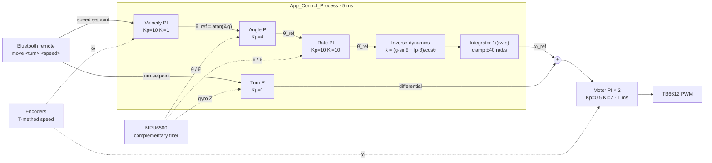

<div align="center">

# 🛞 blance_car

**A two-wheel self-balancing robot on the STM32F103C8T6**

Angle + rate loops · inverse dynamics · velocity & turn loops · Web Bluetooth remote · pure HAL


[](LICENSE)
[](https://github.com/tthc8t6/blance_car/releases/latest)

[Features](#-features) · [Control](#-control-architecture) · [Hardware](#-hardware) · [Getting Started](#-getting-started) · [Remote](#-bluetooth-remote) · [Layout](#-project-layout) · [Lessons Learned](#-lessons-learned) · [License](#-license)

</div>

---

## ✨ Features

- **Five cascaded loops**: motor PI → rate PI → angle P → velocity PI, plus a turn P loop. Every gain is backed by a transfer-function derivation.
- **Inverse dynamics (feedback linearization)**: an algebraic inverse of the inverted pendulum sits between the rate loop and the motor loop, instead of a plain chain of PIDs.
- **Lightweight PID module**: trapezoidal integration with the integral stored pre-multiplied by Ki, so the output clamp also bounds the integral.
- **Fall guard**: stops at a tilt above 80°, and resumes only after the car is held within 10° of upright for **0.5 s continuously**, so it doesn't fall again while being picked up.
- **MPU6500 config self-repair**: the gyro range register is read back every 100 ms; if the chip has reset, it is reconfigured on the fly.
- **Web Bluetooth remote**: WASD in desktop Chrome / Edge, an on-screen stick in Bluefy on iPhone. No app to install.
- **Battery gauge**: TIM2 triggers ADC injected conversions; fully interrupt-driven, three LEDs show the 2S LiPo charge.
- **No RTOS**: apart from the battery monitor, everything runs as non-blocking periodic tasks polled from `main()`.

## 🧠 Control Architecture



| Loop | Feedback | Type | Gains | Output limit | Period |
|---|---|---|---|---|---|
| Motor (innermost) | wheel speed ω (encoder) | PI | Kp 0.5 / Ki 7 | duty cycle | 1 ms |
| Rate | pitch rate θ̇ (gyro X) | PI | Kp 10 / Ki 10 | ±125.7 rad/s² | 5 ms |
| Angle | pitch θ (complementary filter) | P | Kp 4 | ±12.57 rad/s | 5 ms |
| Velocity (outermost) | ω·rw + θ̇·(lp+rw) | PI | Kp 10 / Ki 1 | ±0.5 g | 5 ms |
| Turn | yaw rate (gyro Z) | P | Kp 1 | ±10 rad/s | 5 ms |

> [!NOTE]
> The `θ̇·(lp+rw)` term in the velocity feedback cancels the wheel motion caused by the body swinging. Without it, the wheels "chasing" a forward lean would look like forward travel to the velocity loop and create positive feedback.

The motor model comes from measured parameters, `Gm(s) = 5.591 / ((s/14.2+1)(s/1962.2+1))`. The motor PI is designed by pole-zero cancellation, giving a closed loop of roughly `1/(s/40+1)` (τ ≈ 25 ms).

## 🔧 Hardware

| Part | Model | Notes |
|---|---|---|
| MCU | STM32F103C8T6 | Cortex-M3 72 MHz, 64 KB Flash / 20 KB RAM |
| IMU | MPU6500 module | hardware I2C1 @ 400 kHz, ±2000 dps / ±2 g, DLPF 92 Hz |
| Motor driver | TB6612FNG | dual H-bridge |
| Motors | geared DC motors with AB-phase encoders × 2 | gear ratio ≈ 20.4; phase A on EXTI for timing, phase B for direction |
| Bluetooth | ECB02 BLE transparent module | 9600 baud, works with iOS |
| Battery | 2S LiPo (6.0 – 8.4 V) | voltage sampled through a divider |

<details>
<summary><b>📌 Pin map (click to expand)</b></summary>

| Pin | Function |
|---|---|
| PB0 | ADC1_IN8 battery voltage |
| PA4 / PA5 / PA6 | battery LEDs (low → high) |
| PA11 | start/stop button (pull-up, active low) |
| PA1 | TB6612 STBY (1 = enabled) |
| PA8 (TIM1_CH1) | left motor PWM |
| PA9 / PA10 | left motor AIN1 / AIN2 |
| PB6 (TIM4_CH1) | right motor PWM |
| PB5 / PB7 | right motor BIN1 / BIN2 |
| PB14 / PB15 | left encoder phase A (EXTI) / phase B |
| PB3 / PB4 | right encoder phase A (EXTI) / phase B |
| PB8 / PB9 | I2C1 remapped SCL / SDA → MPU6500 (0x68) |
| PB10 / PB11 | USART3 TX / RX → ECB02 |
| USART2 | VOFA+ telemetry (test programs only) |

</details>

## 🚀 Getting Started

### Requirements

- Keil MDK-ARM 5 (ARMCC v5.06)
- STM32CubeMX (only to change peripheral config; project file `blance_car.ioc`)
- An ST-Link probe (Keil's built-in download or OpenOCD)

### Flash a prebuilt firmware

Same hardware and no Keil? Download `blance_car.hex` from the [latest release](https://github.com/tthc8t6/blance_car/releases/latest) and flash it with STM32CubeProgrammer, ST-Link Utility or OpenOCD (command below).

### Build & Flash

```bash
git clone https://github.com/tthc8t6/blance_car.git
```

1. Open `MDK-ARM/blance_car.uvprojx` in Keil
2. Press `F7` to build — expect **0 Error(s), 0 Warning(s)**
3. Connect the ST-Link and press `F8` to download

With OpenOCD:

```bash
openocd -f interface/stlink.cfg -f target/stm32f1x.cfg \
        -c "program MDK-ARM/blance_car/blance_car.hex verify reset exit"
```

### Usage

1. Power on and hold the car **upright**
2. Press the **PA11 button** to enable the motors — the car starts balancing
3. Drive forward, backward and turn with the Bluetooth remote
4. **Press the button to stop before lifting the car**, and press it again after putting it down (see [Known Issues](#-roadmap--known-issues))

> [!WARNING]
> Never halt the CPU with a debugger while the motors are enabled. The timers keep outputting PWM at the last duty cycle during a halt, and the motors run uncontrolled.

## 📱 Bluetooth Remote

Open the **[web remote](https://tthc8t6.github.io/blance_car_rc/)** (source in [`tools/rc_web/`](tools/rc_web/index.html)):

| Platform | Browser | Controls |
|---|---|---|
| Windows / macOS / Android | Chrome, Edge | `W A S D`, space = stop |
| iPhone / iPad | [Bluefy](https://apps.apple.com/app/bluefy-web-ble-browser/id1492822055) | on-screen stick (Safari has no Web Bluetooth) |

**Protocol**: write text to characteristic `FFF2` of BLE service `FFF0`, one line every 50 ms:

```text
move <turn> <speed>\n        # turn, speed ∈ [-100, 100]
```

| Argument | Mapping | Max |
|---|---|---|
| `speed` | velocity setpoint = −speed × 0.01 × 0.7 m/s | ±0.7 m/s |
| `turn` | turn setpoint = −turn × 0.01 × 15 rad/s | ±15 rad/s |

<details>
<summary><b>Manual test with LightBlue / nRF Connect</b></summary>

The text box can't send `\n`, so write `FFF2` in **Hex** format:

| Command | Hex |
|---|---|
| `move 0 50\n` | `6D6F766520302035300A` |
| `move 0 0\n` | `6D6F7665203020300A` |

</details>

## 📂 Project Layout

```text
blance_car/
├── Core/
│   ├── Inc/
│   │   └── task.h              # PERIODIC(ms) non-blocking periodic task macro
│   └── Src/
│       ├── main.c              # init order + main loop
│       ├── app_control.c       # ⭐ balance control: velocity/angle/rate/turn loops + inverse dynamics + fall guard
│       ├── app_motor.c         # per-wheel speed PI, voltage compensation duty = U / Vbat
│       ├── app_mpu6500.c       # MPU6500 driver + complementary filter + config self-repair
│       ├── app_encoder.c       # quadrature decoding + T-method speed + µs timebase
│       ├── app_rc.c            # USART3 interrupt RX + move command parser
│       ├── app_pwm.c           # duty → H-bridge direction pins + compare registers
│       ├── app_button.c        # button debounce + start/stop toggle
│       ├── app_bat.c           # battery voltage scaling + LEDs
│       ├── pid.c               # generic PID (trapezoidal integral + output clamp)
│       └── quick_math.c        # lookup-table sin/cos/atan
├── test/                       # per-module bring-up programs (encoder, PWM, IMU, motor PID, math)
├── tools/rc_web/index.html     # Web Bluetooth remote
├── skills/                     # Claude Code skills used by this project (toolchain, note-taking)
├── CLAUDE.md                   # project notes for Claude Code
├── MDK-ARM/                    # Keil project
└── blance_car.ioc              # STM32CubeMX config
```

**Main-loop scheduling:**

```text
while (1) {
    App_Button_Process();    // button: start/stop + controller reset
    App_MPU6500_Process();   // 5 ms: read IMU → complementary filter
    App_Control_Process();   // 5 ms: balance control → wheel speed setpoints
    App_Motor_Process();     // 1 ms: measure speed → motor PI → PWM
    App_RC_Process();        // parse a remote command once a full line arrives
}
```

Each test function in `test/` contains its own infinite loop. Uncomment its call in `main.c` to debug that module on its own.

## 🐛 Lessons Learned

Problems hit and solved during development, for anyone building something similar:

<details>
<summary><b>High-frequency buzz: MPU6500 lost its config after a failed init</b></summary>

**Symptom**: right after power-on the body vibrates at about 24 Hz (it tingles to the touch), and the battery LEDs drop.

**Cause**: the MPU6500 may need up to 100 ms after power-on before it accepts writes. The original driver returned on the first failed write, leaving the chip at its default ±250 dps range while the firmware still scaled for ±2000 dps. **Every angular rate read 8× too large**, the turn loop's effective gain went up 8×, and the system went unstable.

**Fix**: init no longer returns early; after the 100 ms delay it writes every register. On top of that, `GYRO_CONFIG` is read back every 100 ms and the chip is reconfigured if it doesn't match.

**Diagnostic tip**: if the gyro bias at rest is about 8× its usual value, the MPU has lost its config.

</details>

<details>
<summary><b>HAL UART interrupt only receives the first byte</b></summary>

`HAL_UART_Receive_IT` is **one-shot** — call it again inside every `HAL_UART_RxCpltCallback`. On an overrun error (ORE), HAL aborts reception and calls `HAL_UART_ErrorCallback` instead; re-arm there too, or the UART stops receiving for good.

</details>

<details>
<summary><b>Float literals without an f suffix cost 1.7 KB of code</b></summary>

The Cortex-M3 has no FPU. `0.005` is a `double` and pulls in the software double-precision library. Write every float literal as `0.005f`.

</details>

<details>
<summary><b>The integrator ran up to 4252 rad/s in standby</b></summary>

The control loop keeps running while the motors are in standby, so with the wheels stopped the integral keeps growing. Two fixes: clamp ω_ref to ±40 rad/s, and call `App_Control_Reset()` on every button press to clear all PID states and motor setpoints (note that `pid_reset` does not clear the setpoint).

</details>

<details>
<summary><b>Don't use HAL_Delay for the fall guard</b></summary>

A `HAL_Delay(1000)` in the control path freezes the 1 ms motor loop, so the PWM stays at the saturated duty from the moment of the fall and the wheels spin on the ground. Record a timestamp instead and check that the car has stayed upright for 0.5 s.

</details>

<details>
<summary><b>Bluefy fails to connect with the error message "undefined"</b></summary>

Bluefy requires the full 128-bit UUID string (`0000fff0-0000-1000-8000-00805f9b34fb`). The 16-bit form `0xfff0` works in Chrome but fails in Bluefy.

</details>

## 📋 Roadmap / Known Issues

- [x] Closed-loop motor speed control
- [x] Angle + rate loops, balancing on the ground
- [x] Velocity loop to hold position
- [x] Turn loop + Bluetooth remote
- [x] Fall guard with upright-hold recovery
- [x] MPU6500 config self-repair
- [ ] **Lift detection**: when the car is lifted, the velocity-loop integral saturates and the car runs forward after being put down (currently worked around by resetting with the button)
- [ ] **Remote timeout**: if Bluetooth disconnects, the car keeps executing the last command
- [ ] Gyro bias calibration at power-on
- [ ] Damp the remaining small wobble (~1.4 Hz, ±3°)

## 🙏 Acknowledgements

- The control derivation and tuning approach come from the Bilibili balance-car course [《平衡车要开课了，先来个原地起飞~》](https://www.bilibili.com/video/BV1wdqhY4E3R/) — thanks to the course author for the lectures and reference firmware
- [STMicroelectronics STM32CubeF1](https://github.com/STMicroelectronics/STM32CubeF1) HAL library
- [VOFA+](https://www.vofa.plus/) serial plotting tool

## 📄 License

The code written for this project is released under the [MIT License](LICENSE). STM32 HAL and CMSIS under `Drivers/` keep their own licenses from STMicroelectronics and Arm. The course material credited above belongs to its author and is not included in this repository.

---

<div align="center">

If this project helped you, a ⭐ star is appreciated

</div>
